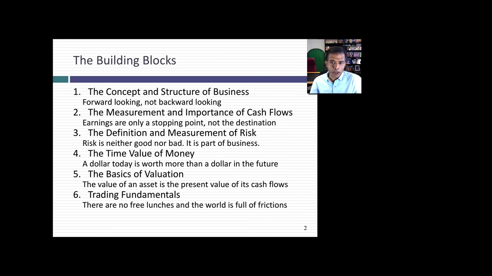
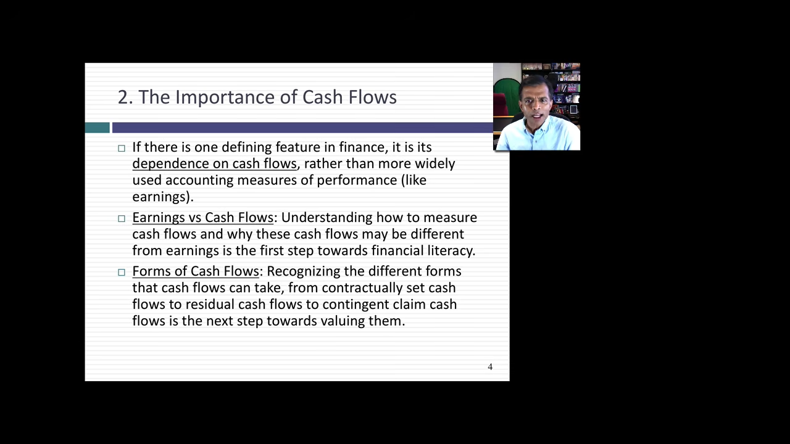
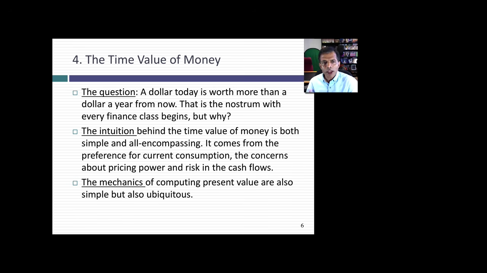
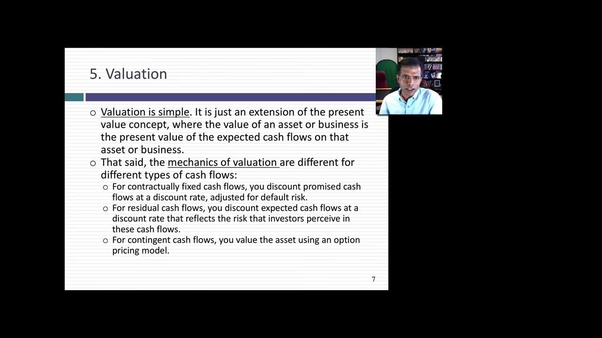
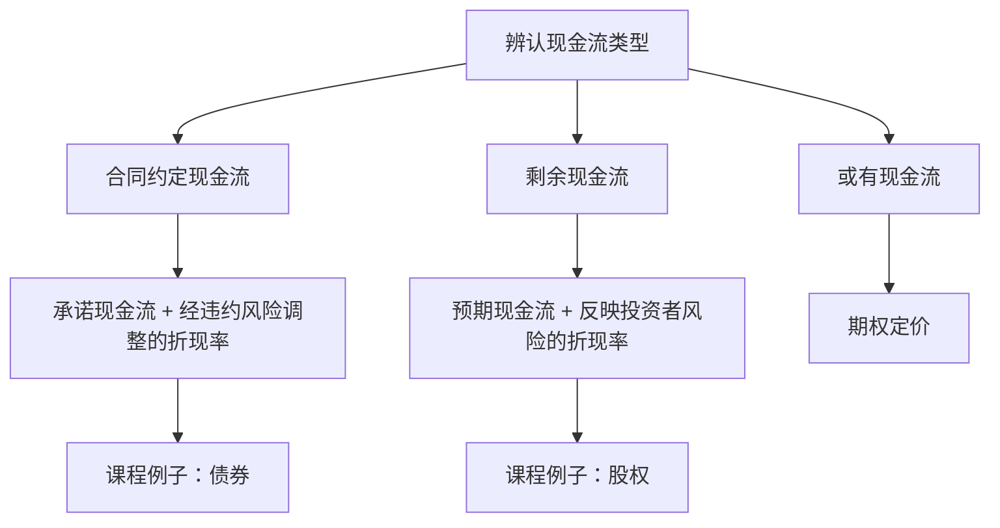

# 金融第一步：理解企业价值的六个基础

> **课程**：Foundations of Finance · Session 1: First Steps in Finance  
> **讲者**：Aswath Damodaran  
> **来源**：[观看原视频](https://www.youtube.com/watch?v=aK4qHbDkJ-s) · 2020 年 7 月 30 日 · 约 11 分钟  
> 本书依据英文字幕校读、翻译与编排，保留课程的核心论证、例子和时间索引。它是一讲课程导论，重点在概念及其联系。

[TOC]

## 一、从企业内部向外看，从企业外部向内看

**对应视频：[00:03—01:15](https://www.youtube.com/watch?v=aK4qHbDkJ-s&t=3s)**

“一切都与钱有关。”这句话听起来直白，却概括了讲者理解金融（finance）的出发点。企业中的战略、营销、人员关系和公共关系，最终都会涉及资源如何投入、如何取得回报，以及价值如何形成。因此，金融处于企业经营的核心。

公司金融（corporate finance）与估值（valuation）研究的是同一家企业，只是观察方向不同。

| 观察方式 | 公司金融 | 估值 |
| --- | --- | --- |
| 立足点 | 从企业内部向外看 | 从企业外部向内看 |
| 主要问题 | 怎样做财务决策、经营好企业、创造价值？ | 怎样理解这家企业的价值？ |
| 与另一门课的联系 | 研究创造价值的决策 | 从外部观察这些决策所指向的企业价值 |

这两种视角共享一套基础语言：企业、现金流（cash flows）、风险（risk）、时间、价值和交易（trading）。讲者将它们概括为六个基础构件（building blocks），同时强调，这是一种个人的课程组织方式，并非唯一可能的分类。

## 二、六个基础构件如何连接

**对应视频：[01:15—03:39](https://www.youtube.com/watch?v=aK4qHbDkJ-s&t=75s)**

金融的思考始终面向未来（forward-looking）。判断一家企业时，关键在于预计它未来会做什么、产生什么，而不只是过去已经做过什么。其余概念都围绕这条主线展开。

| 基础构件 | 本讲提出的核心问题 |
| --- | --- |
| 企业的概念与结构 | 企业拥有怎样的资产，又如何为这些资产筹资？ |
| 现金流（cash flows） | 企业会带来什么现金流？为什么它与会计盈余（accounting earnings）、资产账面价值（book value of assets）不同？ |
| 风险（risk） | 如何定义、衡量风险，并确定应当采用谁的风险视角？回报是否足以补偿风险？ |
| 货币时间价值（time value of money） | 不同时点的现金流如何比较？为什么币种重要，时间价值又为何可能随时间变化？ |
| 估值（valuation） | 不同性质的现金流，需要怎样的估值方法？ |
| 交易（trading） | 金融市场如何帮助企业运转？为什么不投入资金、不承担风险的获利机会难以持续？ |

金融市场（financial markets）被讲者比作企业运转的“润滑剂”。它们未必是企业存在的必要条件，却有助于企业良好运作。理解交易因此也是理解金融的一部分。

后面的内容按这六个构件逐一展开。它们既是课程的知识地图，也是后续学习公司金融（corporate finance）和估值的共同起点。

## 三、企业：从过去的投入转向未来的收益

**对应视频：[03:39—04:45](https://www.youtube.com/watch?v=aK4qHbDkJ-s&t=219s)**

### 资产一侧：未来能带来什么

会计资产负债表（accounting balance sheet）通常是人们理解企业的起点。它呈现资产（assets）与负债（liabilities）；讲者进一步提出财务资产负债表（financial balance sheet），用来说明金融中的企业观。

两种视角都观察企业的资产与融资，但金融更关注一个面向未来的问题：**这些资产将来能为企业带来什么？**

因此，已经在某项资产上投入多少钱，并不能直接回答这项资产的价值问题。金融关心的是对未来收益的预期。这一转向会改变我们看待资产负债表资产一侧的方式。

### 融资一侧：债务与股权

在资金来源上，讲者把企业融资归结为两种基本方式。

| 方式 | 课程中的解释 | 术语 |
| --- | --- | --- |
| 借来的钱 | 企业向他人借入资金 | 债务（debt） |
| 自己的钱 | 以所有者投入的资金经营企业 | 股权（equity） |

随着企业扩大，债务和股权可能发展出不同层次和形式，但课程在概念层面仍将融资归为这两类。

企业这一构件建立了两个互相联系的问题：资产未来能产生什么，以及支持这些资产的资金来自哪里。

## 四、现金流：先看实际现金，再辨认权利类型

**对应视频：[04:45—05:52](https://www.youtube.com/watch?v=aK4qHbDkJ-s&t=285s)**

### 现金流为什么不能与盈余混用

我们掌握的企业信息，往往以会计资料和会计盈余（accounting earnings）的形式出现。但金融分析关心的核心对象是现金流（cash flows），二者可能不同。

理解这种差异，才能理解讲者提出的现象：有些企业按会计标准看表现很好，却未必很有价值；另一些企业的会计表现不好看，却可能价值很高。

本讲提出这一差异的重要性，没有进一步列出从盈余调整到现金流的计算步骤。这里要先建立的认识是：**看到盈余数字之后，还需要继续追问现金流。**

### 三种现金流

| 现金流类型 | 由什么决定 | 视频中的例子或说明 |
| --- | --- | --- |
| 合同约定现金流（contractually set cash flows） | 在签订协议时约定 | 公司债券（corporate bond）、银行贷款（bank loan） |
| 剩余现金流（residual cash flows） | 属于企业所有者或股权（equity）投资者的剩余现金流 | 企业所有者、股权投资者所取得的现金流 |
| 或有现金流（contingent cash flows） | 以另一个事件发生为条件 | 只有某件事发生，相关现金流才会发生 |

这项分类直接影响估值（valuation）。在选择工具之前，先辨认自己面对的是合同约定的支付、所有者的剩余现金流，还是以事件为条件的现金流。

## 五、风险：找到合适的风险，并明确由谁观察

**对应视频：[05:52—07:12](https://www.youtube.com/watch?v=aK4qHbDkJ-s&t=352s)**

“人具有风险厌恶（risk averse）的倾向”是金融中常见的说法。本讲没有把它当作一句可以直接略过的口号，而是要求进一步理解：这个结论意味着什么，如何得出，又如何进入决策？

### 风险具有两面性

风险（risk）既有不利的一面，也有有利的一面。成为一家出色的企业，往往需要主动寻找风险。关键在于寻找合适的风险，并使其中的权衡（trade-off）对自己有利。

因此，风险厌恶（risk aversion）并不意味着企业应当回避一切风险。金融需要把风险与回报放在一起考虑：预期取得的回报，是否足以补偿承担的风险？

### 同一项决策，可能有不同的风险视角

想象一家上市公司（publicly traded company）。它可能拥有成千上万的股东（shareholders），也有负责经营的管理者（managers）。不同的人，对同一项决策可能有不同的风险判断。

这就引出一个必须先回答的问题：**应该从谁的眼中看风险？哪一种风险视角应当主导决策？**

本讲提出这个问题，没有在此选定答案。它提醒我们，在讨论风险大小之前，应先明确观察风险的人是谁。

### 把风险视角转化为可用的数值

确定视角后，还需要把它转化为风险数值（risk number），以便明确地纳入决策。讲者认为，风险衡量方法的发展史，与金融学的发展历程紧密相伴。

这部分的学习顺序可以整理为：理解风险的两面性，明确风险的观察者，再寻找能用于决策的衡量方式。

## 六、货币时间价值：把现金流放到同一个时点

**对应视频：[07:12—08:01](https://www.youtube.com/watch?v=aK4qHbDkJ-s&t=432s)**

讲者用一个具体画面说明货币时间价值（time value of money）的地位：如果你学过金融，可以看看自己的财务计算器（financial calculator），现值（present value，PV）按钮是不是已经磨损得很厉害？大量金融问题最终都涉及现值。

“今天的一美元比一年后的一美元更值钱”，是课程用来引入这个主题的常见说法。学习的重点，是理解背后的直觉，并将直觉转化为实际计算能力。

面对一组现金流（cash flows），学习者至少需要能回答两个问题：

1. 能否把它们换算到今天？
2. 能否把它们换算到未来的另一个时间点？

在前面的课程总览中，讲者还提醒我们关注币种，以及货币时间价值本身随时间变化的问题。本讲给出的是后续学习的方向，尚未展开具体公式、数值算例或成立条件。

这项能力把现金流的“金额”与“发生时间”联系起来，也为估值（valuation）建立了共同的时间基准。

## 七、估值：现金流不同，方法也不同

**对应视频：[08:01—09:14](https://www.youtube.com/watch?v=aK4qHbDkJ-s&t=481s)**

讲者对估值（valuation）的基本态度是：只要保持简单，估值本身可以很简单；很多复杂性来自我们把问题复杂化。回到前面三类现金流（cash flows），便能看清估值方法的主要区别。

讲义还将估值与现值（present value）直接联系起来：资产或企业的价值，来自其预期现金流（expected cash flows）的现值。具体计算方式，则随现金流的类型而变化。

### 合同约定现金流：折现承诺支付

对合同约定现金流（contractually set cash flows），课程采用承诺现金流（promised cash flows），并以经违约风险调整的折现率（default risk adjusted discount rate）进行折现（discount）。

债券就是例子。它的承诺现金流包括票息（coupons）与面值（face value）；用于折现的，是经违约风险调整的债务成本（cost of debt）。

“由合同约定”与“实际支付没有风险”是不同的问题。本讲在折现率中明确纳入违约风险，说明合同承诺仍需要相应的风险处理。

### 剩余现金流：估计预期，再反映投资者的风险

对剩余现金流（residual cash flows），先估计未来的预期现金流（expected cash flows），再按照能够反映投资者所面对风险的利率折现。课程用这一路径解释股权（equity）估值。

这里连接了前面关于风险（risk）的讨论：估值所采用的风险处理，需要与投资者面对的现金流相对应。

### 或有现金流：使用期权定价

对或有现金流（contingent cash flows），讲者提出使用另一套工具——期权定价（option pricing）。本讲只说明工具的选择，具体原理将留给后续内容。

下图依据本讲口述整理，表示三类现金流与估值方法的对应关系：

这一节提供的是估值的基本分类框架。掌握这些基础，是进一步处理各种估值对象的起点。

## 八、交易与摩擦：为什么免费午餐难以持续

**对应视频：[09:14—11:05](https://www.youtube.com/watch?v=aK4qHbDkJ-s&t=554s)**

金融市场（financial markets）帮助企业运转，因此理解买入、卖出与交易（trading）也是金融的基础。

### 套利的理想

每位交易者都希望找到这样的机会：不承担风险，却获得高于无风险利率（risk free rate）的回报。讲者又用一个更鲜明的描述引出套利（arbitrage）：不投入资金、不承担风险，却能够带着利润离场。

这样的机会在现实中极难找到；即使出现，也可能转瞬即逝。本讲由此引出市场摩擦（frictions in the market place），并重点指出两项：交易成本与税收。

### 交易成本不止一笔手续费

一提到交易成本（trading costs），人们也许首先想到某次交易要支付的 4.95 美元。但讲者明确提醒，交易成本还包括其他在交易时不容易被想到的项目。

本讲没有逐项展开这些额外成本，因此这里也不补列清单。需要保留的认识是：**只看到表面的交易费用，还不足以理解交易中的全部成本。** 这也是为什么“免费午餐”如此难找。

这里的 4.95 美元是原视频中的教学例子，不代表当前某个平台的收费。

### 投资者最终能花掉的是税后现金流

讲者引用关于“死亡和税收”的老话，并开玩笑说，自己甚至对死亡都不那么确定。玩笑之后，是一个明确的金融判断：税收（taxes）必须进入投资决策，因为投资者真正能花掉的是税后现金流（after tax cash flows）。

因此，税收应当被纳入决策、交易与投资的分析过程。忽略税收，就没有完整地回答投资者最终能够得到什么。

### 用六个问题回看本讲

1. 面对一家企业，能否区分从内部创造价值与从外部观察价值的视角？
2. 面对企业数据，能否继续追问现金流，而不只停留在盈余数字？
3. 讨论风险时，能否说明风险的两面性、观察者与衡量方法？
4. 面对不同时点的现金流，能否说明为什么需要做时间换算？
5. 面对一项资产，能否先辨认现金流类型，再选择估值思路？
6. 面对看似确定获利的交易，能否把交易成本与税收纳入判断？

这些问题对应公司金融（corporate finance）与估值（valuation）两门课程共同的地基。先把概念及其联系理解清楚，再进入后续的方法与计算。

### 字幕校读说明

原始平台字幕含有滚动显示造成的重复，以及若干明显的术语识别错误。校读保留了全部原始记录，并另存英文订正稿与逐段中文译稿。00:10、02:12、10:06、10:09 附近的四处口语连接短语仍有疑点，已在字幕及记录中标注；本书依据可确认的上下文组织相应段落，没有把这些短语当作已核实的逐字引文。
