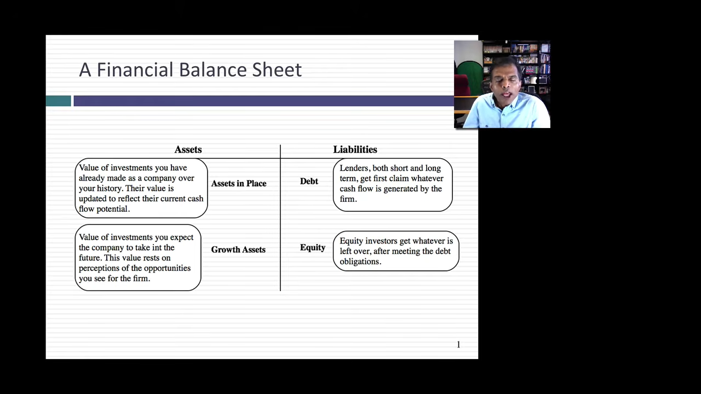
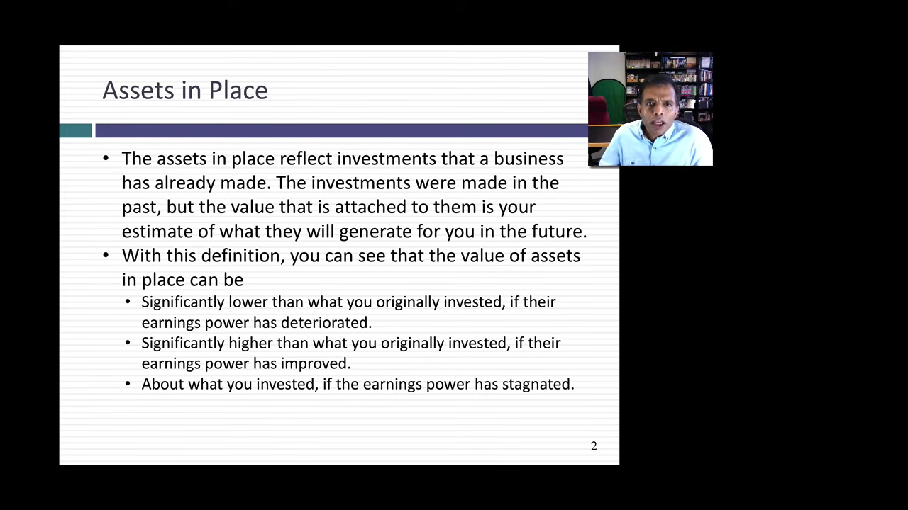
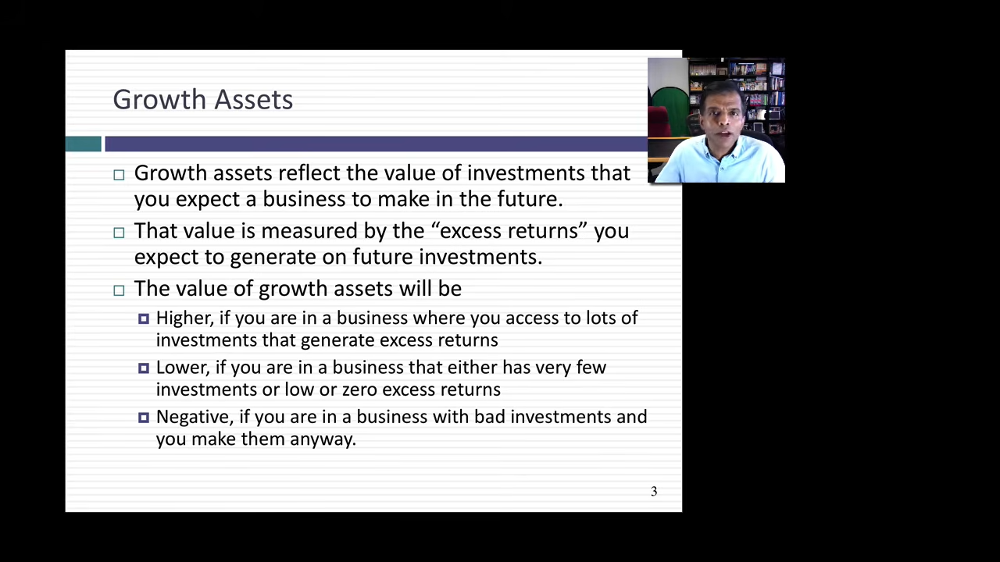
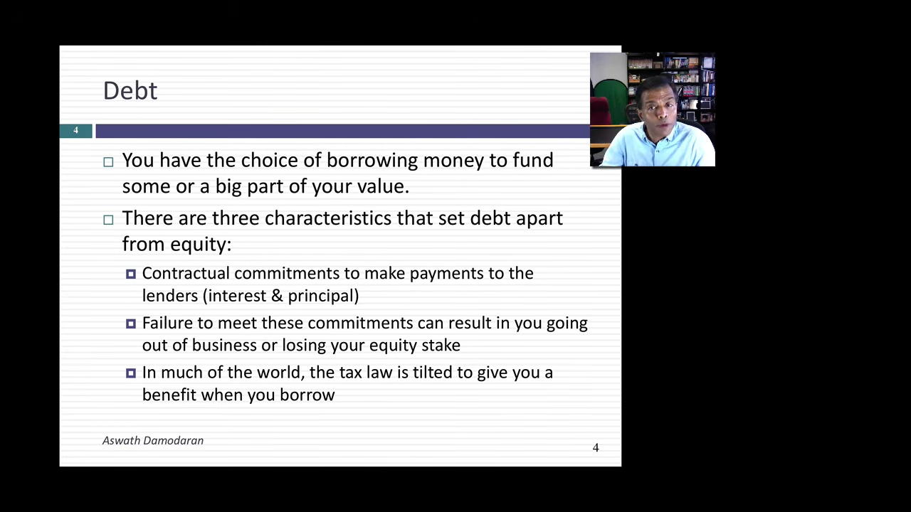
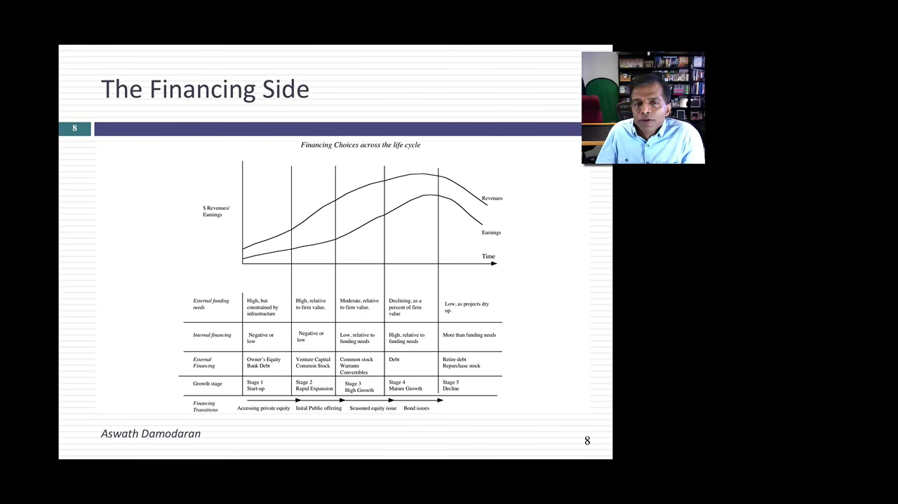
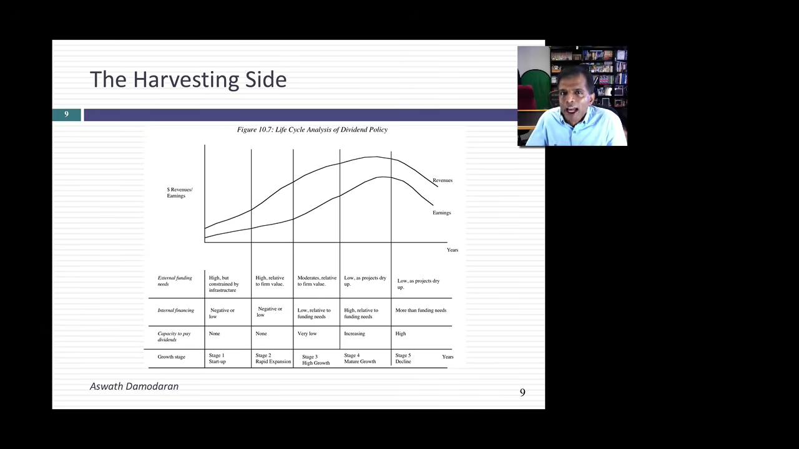

# 企业的结构：财务资产负债表与企业生命周期

> **课程**：Foundations of Finance · Session 2: The Structure of a Business  
> **讲者**：Aswath Damodaran  
> **来源**：[观看原视频](https://www.youtube.com/watch?v=TKoLoLVI_Js) · 13 分 13 秒  
> 本讲从企业拥有的资产与筹资方式出发，说明财务资产负债表的四个基本项目，再考察它们如何随企业生命周期变化。

[TOC]

## 一、用四个项目理解一家企业

**对应视频：[00:03—01:43](https://www.youtube.com/watch?v=TKoLoLVI_Js&t=3s)**

理解企业，可以先从资产负债表（balance sheet）入手。会计资产负债表（accounting balance sheet）把资产分成固定资产（fixed assets）、流动资产（current assets）、无形资产（intangible assets）、金融资产（financial assets）等类别，在另一侧列示流动负债（current liabilities）、长期负债（long-term liabilities）、股东权益（shareholders' equity）等项目。

讲者提出的财务资产负债表（financial balance sheet），把这些项目重新组织为四个基本概念：**资产一侧看投资何时形成，融资一侧看钱从哪里来。**

| 资产一侧：企业的价值来自哪里 | 融资一侧：企业如何取得资金 |
| --- | --- |
| **既有资产（assets in place）**：企业已经完成的投资 | **债务（debt）**：借来的钱 |
| **增长资产（growth assets）**：预期未来投资所带来的价值 | **股权（equity）**：所有者投入的钱 |

在这一框架下，一项资产究竟是厂房、软件还是其他无形资产，并不是首要分类标准。更关键的问题是：它属于已经进行的投资，还是未来才会进行的投资？

对增长资产的判断可以延伸到明年、两年后、五年后，乃至更远的未来。因此，金融中的估值（valuation）可能会为企业尚未想清楚的投资机会赋予价值。这也预示了这个框架的难点：形式虽然简单，判断却依赖对未来的估计。

公司金融（corporate finance）和估值都要反复使用这四个概念。接下来，先分别理解它们，再把它们放到企业的一生中观察。

## 二、既有资产：已经投入的钱，不等于今天的价值

**对应视频：[01:43—03:37](https://www.youtube.com/watch?v=TKoLoLVI_Js&t=103s)**

既有资产（assets in place）对应企业已经做出的投资。讲者给出两类例子：

| 企业 | 既有资产的例子 |
| --- | --- |
| 通用汽车（GM）、福特（Ford）等传统汽车企业 | 汽车工厂、装配厂和已有生产设施 |
| 微软（Microsoft） | Windows、Office 等已经投入开发的产品 |

这些例子也说明，既有资产不只包括看得见、摸得着的厂房。只要投资已经形成，并能支撑企业经营，就可以从既有资产的角度观察。

### 价值取决于未来产出

金融中的问题是：**这些资产未来能够产生多少现金流（cash flows）？** 过去投入了多少资本，只是另一项信息。即使企业曾经花费数十亿美元，也不能据此认定资产今天仍然值同样多的钱。

因此，既有资产的价值与已投入资本（capital invested）之间，可能出现三种关系。

| 资产的表现 | 价值与原有投入的可能关系 |
| --- | --- |
| 已经难以产生收益 | 价值可能远低于会计报表上的金额 |
| 产出能力大幅提高 | 价值可能远高于原先投入的资本 |
| 大致维持最初投资时的表现 | 价值可能接近原有投入 |

这里的“可能”很关键。讲者是在说明为什么两者可以偏离，而不是提供一条只靠历史投入就能算出价值的公式。

财务资产负债表（financial balance sheet）因此具有面向未来（forward-looking）的特点。虽然这些投资发生在过去，今天给它们估值（valuation）时，仍要问它们今后能够创造什么。

## 三、增长资产：增长怎样创造价值，又怎样破坏价值

**对应视频：[03:37—05:42](https://www.youtube.com/watch?v=TKoLoLVI_Js&t=217s)**

增长资产（growth assets）代表预期未来投资带来的价值。它的大小取决于投资能否获得超额回报（excess return），而不只是企业准备投多少钱。

投入资金本身并不自动创造价值，因为这笔钱必须筹集而来，筹资也有成本。讲者用同一笔 **10 亿美元** 的未来投资，比较三种情形。

| 计划投资 | 筹资成本 | 项目回报率 | 对增长资产价值的含义 |
| --- | --- | --- | --- |
| 10 亿美元 | 10% | 30%、40% 或 50% | 项目回报高于筹资成本，增长创造价值 |
| 10 亿美元 | 10% | 恰好 10% | 企业规模扩大，但增长资产的新增价值可以为零 |
| 10 亿美元 | 10% | 只有 5% | 回报不足以补偿筹资成本，增长资产可以具有负价值 |

### 企业变大与企业增值是两个问题

第二种情形最容易被忽略。企业确实增加了投资，也可能拥有更多项目与资产，但如果项目恰好只赚到筹资成本，规模扩大并没有为企业带来额外价值。

第三种情形更加严峻：如果企业不断把资金投入回报率不足的项目，增长反而会加速价值损失。这里的负价值，指的是这些未来投资对企业价值的负面贡献。

所以，拥有巨大增长潜力还不够，还要能够获得足够的超额回报。对于只能原地踏步的企业，增长资产可能没有价值；对于选择了达不到必要收益率（required rate of return）的项目的企业，增长可能破坏价值。

讲者把这件事视为公司金融（corporate finance）与估值（valuation）的共同核心：经营企业，要确保未来投资能够创造价值。如果找不到这样的投资，就应停止把价值创造寄托在这些增长项目上。

## 四、债务：从合约承诺识别融资的实质

**对应视频：[05:42—07:17](https://www.youtube.com/watch?v=TKoLoLVI_Js&t=342s)**

债务（debt）并不能简单等同于资产负债表（balance sheet）上某个标签下的总数。银行贷款（bank loans）和公司债券（corporate bonds）很容易辨认，但有些具有债务性质的项目，未必会以显眼的债务项目出现。本讲暂不展开具体例子，而是给出三个识别特征。

### 1. 存在事先确定的付款承诺

债务包含合约承诺（contractual commitment）：企业承诺在未来付款。与之相比，企业发行股权（equity）时说自己打算支付股息（dividend），在讲者的比较中，并不等同于债务合约规定的付款义务。

**合约承诺不要求付款金额始终固定。** 它可以约定一个固定金额，也可以约定随其他因素变化的付款规则。例如，浮动利率债务（floating-rate debt）的付款金额会变化，但决定付款的规则在事先就已经确定。

### 2. 不履约会带来控制权方面的后果

不按约付款可能引起违约（default）、破产（bankrupt），使贷款人接管企业，或使企业被关闭。债务因此与潜在的失去控制权（loss of control）联系在一起。

### 3. 相关付款通常具有税前扣除特征

讲者指出，在世界上许多地方，债务相关付款通常可以税前扣除（tax-deductible）；他也明确保留了“并非所有地方”的限制。

这三个特征共同帮助我们判断一项融资安排是否具有债务实质。具体还有哪些项目应当归入债务，留待后续课程讨论。

## 五、股权：剩余索取权与实际股息之间的距离

**对应视频：[07:17—08:41](https://www.youtube.com/watch?v=TKoLoLVI_Js&t=437s)**

股权（equity）是一种剩余索取权（residual claim）。企业所有者取得的，是满足其他各方需求之后所剩的现金流（cash flows）。

在经营过程中，企业需要偿付贷款人，并满足再投资（reinvestment）需求。剩下的现金流才属于股权投资者。剩余部分可能很多，也可能为零，甚至是负数。

在企业清算（liquidate）时，剩余索取权同样适用：先偿付贷款人，股东才能取得剩余财产。

### 有剩余现金，不代表立即发到股东手中

对上市公司（publicly traded company）的股东来说，剩余现金流（residual cash flow）与实际收到的股息（dividend）之间，还隔着公司管理层。管理层决定，要把多少现金以股息形式支付给投资者。

因此，股息可能等于剩余现金流，也可能远低于它，或在某个时期高于它。讲者把股息称为剩余现金流经过平滑处理（smoothed out）的版本，但也提醒：**股息未必是衡量剩余现金流的可靠数值。**

分析一家企业时，必须区分两个问题：企业经营后有多少现金可以归属于股东，以及管理层实际选择向股东支付多少现金。

## 六、企业生命周期：价值来源如何随年龄变化

**对应视频：[08:41—10:17](https://www.youtube.com/watch?v=TKoLoLVI_Js&t=521s)**

企业生命周期（corporate life cycle）把前面的静态框架变成动态过程。讲者用人的一生作类比：人有出生、成长、成熟与衰退，企业也会经历相应阶段。

初创企业（startup）像刚出生的孩子；年轻成长企业（young growth company）像青少年；成长企业（growth company）接近生命力旺盛的阶段；之后进入成熟企业（mature company）阶段，再走向衰退（decline）。

这个框架的价值，在于帮助理解财务资产负债表（financial balance sheet）为什么会变化，尤其是既有资产（assets in place）与增长资产（growth assets）的相对分量。

| 生命周期位置 | 资产一侧的主要特征 |
| --- | --- |
| 初创 | 几乎全部价值来自增长资产，既有资产很少 |
| 年轻成长 | 既有资产逐步积累，但增长资产仍是价值的主要驱动力 |
| 继续成长、走向成熟 | 既有资产在总价值中的占比逐渐提高 |
| 成熟 | 大部分价值来自既有资产，较少来自增长资产 |
| 衰退 | 增长机会枯竭，价值主要来自既有资产，而既有资产本身也开始缩小 |

当企业已经缺乏能够创造价值的增长机会时，继续强行扩张可能使价值更快流失。因此，不能脱离生命周期阶段，孤立地把“增长更多”视为更好的经营方向。

## 七、融资一侧：为什么年轻企业与成熟企业不同

**对应视频：[10:17—11:28](https://www.youtube.com/watch?v=TKoLoLVI_Js&t=617s)**

企业生命周期（corporate life cycle）不仅改变资产构成，也影响债务（debt）与股权（equity）的搭配。

### 年轻企业：潜力不能拿来支付利息

对初创企业（startup）而言，既有资产（assets in place）尚未充分形成，企业可能还没有收益。这时，讲者主张主要依靠股权，甚至几乎完全依靠股权融资。

原因直接而具体：**承诺与潜力不能用来支付利息（interest payments）。** 企业价值可能很高，但如果价值主要来自未来的增长资产（growth assets），今天仍然未必有足够现金履行债务义务。

年轻成长企业（young growth company）虽然比初创企业走得更远，价值来源仍以增长资产为主，因此融资也仍应以股权为主。

### 成熟与衰退：举债能力先扩大，再进入资金返还

随着企业成熟，举债能力逐步扩大。企业可能选择增加借款，而讲者此前提到的税收待遇，也是选择债务的原因之一。债务在资产负债表（balance sheet）中的比重由此可能上升。

进入衰退（decline）后，企业开始清算资产，并向债权人和股东返还资金。这个阶段的债务与股权构成，会反映资产清算和资金返还的进度。

这一框架把两侧联系起来：理解企业的资产与现金产生能力，有助于解释它采用什么融资方式，以及融资结构为什么会随时间改变。

## 八、收获回报：企业最终怎样把现金交还投资者

**对应视频：[11:28—13:13](https://www.youtube.com/watch?v=TKoLoLVI_Js&t=688s)**

收获回报的一侧（harvesting side）关注投资的最终目的。讲者强调，投资者不仅想看到企业长大，还希望最终取得股息（dividend）或其他现金流（cash flows）。

企业生命周期（corporate life cycle）同样能够解释现金回报为什么会变化。

| 阶段 | 筹资与现金返还的典型关系 |
| --- | --- |
| 初创 | 现金流通常为负，需要筹集资本支持增长 |
| 成长 | 仍然需要资本；即使外部融资需求逐渐下降，现金也常被继续投入企业 |
| 成熟 | 向投资者返还现金的能力提高 |
| 衰退 | 随着资产收缩和清算，现金逐步返还投资者 |

对上市公司（publicly traded company），具备返还能力与实际返还之间仍有差别。如果管理层继续留存现金，公司的现金余额（cash balances）就会积累。讲者指出，这些资金最终仍要回到投资者手中。

理解一家企业为什么扩张、为什么借钱、为什么暂时不分红，可以先问：**它处于生命周期的哪个阶段？** 同一个问题，在企业不同年龄段可能有不同答案。

财务资产负债表（financial balance sheet）用每侧两个项目简化了观察方式，却没有消除判断的难度。既有资产（assets in place）需要估计未来产出，增长资产（growth assets）需要判断未来投资能否增值，融资和现金返还又会随企业阶段而演变。表面上的四个项目，背后连接着对企业未来的一整套判断。

---

**字幕校读说明**：约 02:06—02:10 的汽车企业例子中，原字幕末语识别为 “in life”，具体原词仍有疑点；正文采用上下文明确的“已有生产设施”，未据此扩展结论。
