# Pi：让编程代理适应你

> Mario Zechner 关于最小核心、上下文控制与可扩展编程代理的演讲笔记。原视频：[I Hated Every Coding Agent, So I Built My Own — Mario Zechner (Pi)](https://www.youtube.com/watch?v=Dli5slNaJu0)，Mastra 发布，全长 27 分 15 秒。
>
> 本书依据演讲字幕与画面整理。产品评价、功能取舍及基准排名均指讲者描述的演讲当时情形；其中的个人偏好与推测保留原有归属，不作为这些产品当前状态的结论。

## 一、问题的起点：能生成更多代码之后，工具应该怎样变化？

时间：[00:35–02:17](https://www.youtube.com/watch?v=Dli5slNaJu0&t=35s)

Mario Zechner 原本并不相信编程代理（coding agents）已经实用。2025 年春天，Peter Steinberger 告诉他和 Armin Ronacher：这类工具现在真的能干活了。几个人后来聚在一起，通宵尝试让 AI 写代码，才切身体会到变化。

生产代码的门槛骤降，也带来了一个略带讽刺的现象：人们制造了许多东西，其中不少连自己也不会使用。Mario 的反应逐渐从兴奋变成了不满。他不喜欢现有编程代理背后的代理运行框架（harnesses），于是问自己：写一个适合自己的，究竟会有多难？

这里需要区分模型和运行框架。演讲所讨论的取舍，大多发生在模型外围：哪些工具交给模型，哪些文字放进上下文，何时反馈错误，如何显示工作过程，以及用户能修改哪些行为。同一个模型放进不同运行框架中，用户能观察和控制的东西可能很不一样。

Pi 就是在这个问题下诞生的。它的出发点，是让使用者能够把代理改造成适合自己工作方式的工具。

## 二、从复制粘贴到代理式搜索

时间：[02:17–04:52](https://www.youtube.com/watch?v=Dli5slNaJu0&t=137s)

Mario 回顾了自己经历的几种使用方式。最初，人们把需求交给 ChatGPT，再把代码复制到编辑器中，常见产物是一个函数或一小段不想手写的代码。之后，GitHub Copilot 把补全带进 Visual Studio Code，用户不断按 Tab 接受建议。它有时有效，也会产生错误，甚至出现近乎逐字复述已有代码的情况；演讲以 John Carmack 的平方根倒数代码为例回忆这一问题。

Aider、AutoGPT 是他提到的早期探索者。后来，Claude Code 让他感到编程代理（coding agents）终于形成了一种足够实用的工作方式。

他特别看重的是代理式搜索（agentic search）：模型通过文件工具和 bash，即时探索代码库，寻找相关位置，理解代码，然后修改代码。它不必先依赖复杂的代码索引和抽象语法树（ASTs）索引来安排全部检索过程。

在他的解释中，模型经过相关训练，已经能够使用这些通用工具。把探索能力交给模型，反而得到简单而有效的系统。早期 Claude Code 因而显得可预测，也很贴合他的工作流。

## 三、功能增长与控制权之间的矛盾

时间：[04:52–09:39](https://www.youtube.com/watch?v=Dli5slNaJu0&t=292s)

### 1. “宇宙飞船”比喻

当 AI 能快速写出新功能时，团队很容易不断增加功能。Mario 用 Homer Simpson 设计出的夸张车辆作比喻，称复杂的代理像一艘“宇宙飞船”：用户也许只使用 5% 的功能，知道其中 10%，剩下的像暗物质一样不可见。

这些比例是修辞性的描述，不是使用率统计。它指出的实际问题是：功能越多，用户越难知道代理究竟在做什么。

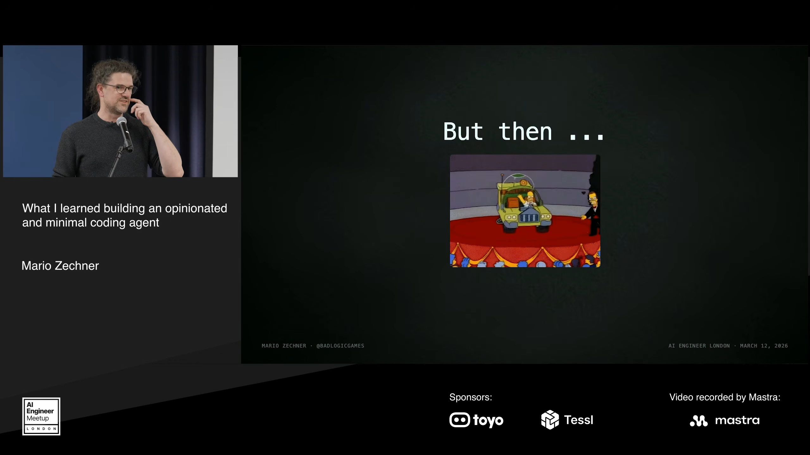

### 2. 终端界面与可预测性

Mario 从游戏开发者的经验出发，反对把终端用户界面（terminal user interface，TUI）称为游戏引擎。他认为，使用 React 并让整个界面频繁重新布局，会引入本可避免的成本；终端本身有能力快速渲染，不应成为所有闪烁问题的替罪羊。

这一段带有强烈的个人表达，但它服务于同一个要求：工具需要稳定、简单、可预测。讲者也明确承认 Claude Code 团队的创造力和成果，并没有把“不再适合自己”等同于“对所有人都不好”。

### 3. 上下文的变化会改变工作流

上下文管理（context management）和上下文工程（context engineering）是更深层的不满。Mario 说，他在 2025 年夏天制作过工具，观察 Claude Code 发往后端的请求，从而查看有哪些额外文字在用户不知情时被加入上下文。

如果注入内容、注入位置或触发时机不断变化，用户已经建立的工作流也可能随之改变。他理解大型产品需要实验，但自己需要掌握更多控制权：哪些信息传给模型、为什么传入、什么时候发生，都应该尽量可观察。

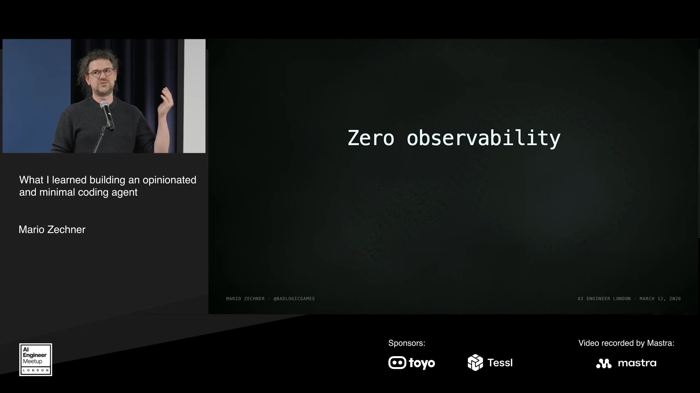

他还提出两点相关取舍：一是模型选择受产品定位约束；二是钩子（hook）系统的扩展能力（extensibility）与深入修改运行框架仍有差别。若每次事件都要启动新进程，反复启动也有成本。

最后的结论是个人适配问题：这款产品可能变得更适合更多人，却不再适合他需要的可观测性（observability）与控制方式。

## 四、考察替代方案：上下文管理也是产品设计

时间：[09:39–12:42](https://www.youtube.com/watch?v=Dli5slNaJu0&t=579s)

Mario 曾考察 Codex CLI、Amp、Factory Droid 和 OpenCode。他说自己起初不喜欢 Codex CLI 的界面与模型，但后来改变了对模型的评价。对 Amp，他尤其欣赏团队愿意删减功能，以及较务实的产品取舍。Factory Droid 也是一个不错的选择，只是在他的体验中没有 Amp 那么爱实验。

开源背景让他自然地尝试 OpenCode。他肯定 OpenCode 团队的务实、迭代速度，以及维护稳定常用路径的努力。不过，开源本身并不能消除他对上下文管理（context management）的顾虑。

### 提示缓存与历史工具结果

演讲展示了 `SessionCompaction.prune` 的例子：每一轮都处理历史工具结果，裁去最近约 40,000 个词元（tokens）之前的工具输出。Mario 把它与提示缓存（prompt caching）联系起来，认为反复改动历史上下文会破坏缓存复用。

对他的设计思路而言，这说明了一个问题：减少上下文内容并非只影响可见文本长度，还可能影响模型请求的成本与基础设施行为。因此，运行框架（harnesses）何时裁剪、裁剪什么，应当是明确的设计决定。

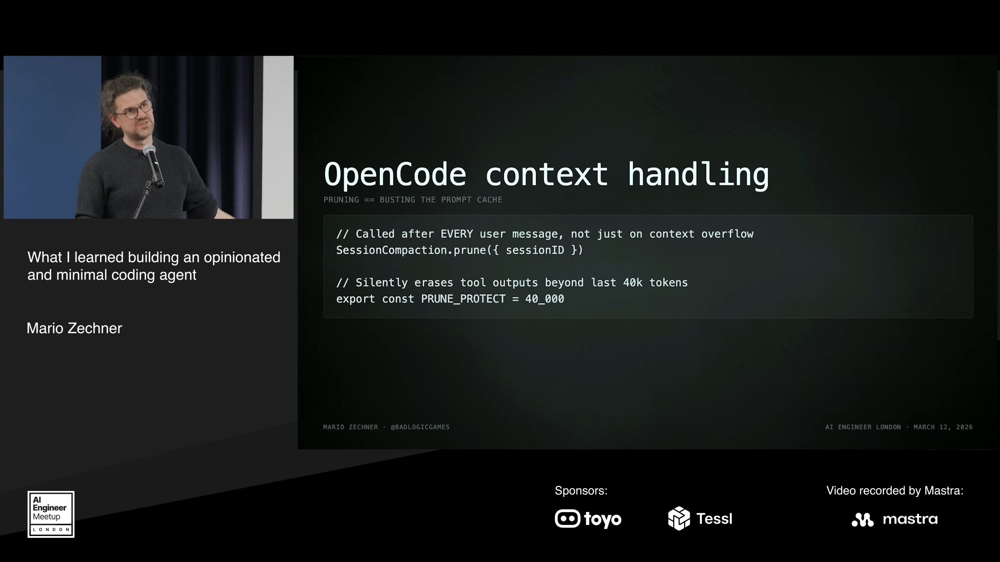

随后，他推测这可能与 Anthropic 和 OpenCode 之间的紧张关系有关，并引用“健身房使用者滥用设施会被禁止进入”的比喻。**他明确说自己没有证据。**因此，这部分只能理解为个人推测，不能当作双方关系的已证实原因。

## 五、检查应该发生在代码完成之后

时间：[12:42–14:13](https://www.youtube.com/watch?v=Dli5slNaJu0&t=762s)

Mario 对语言服务器协议（LSP，language server protocol）集成的批评，核心在于反馈时机。

假设代理要修改多个文件，总共十处改动。完成第一处时，代码往往不能编译；完成第二处时也未必能。接口、调用者和类型定义还没有全部同步，暂时的错误并不意味着整体方案错误。

如果每次编辑后都立即查询 LSP，再把错误信息接在工具结果之后交给模型，模型就会不断收到“你刚才做错了”的反馈。Mario 认为，这些过早的反馈可能干扰尚未完成的编辑计划，甚至让模型放弃原有方向。

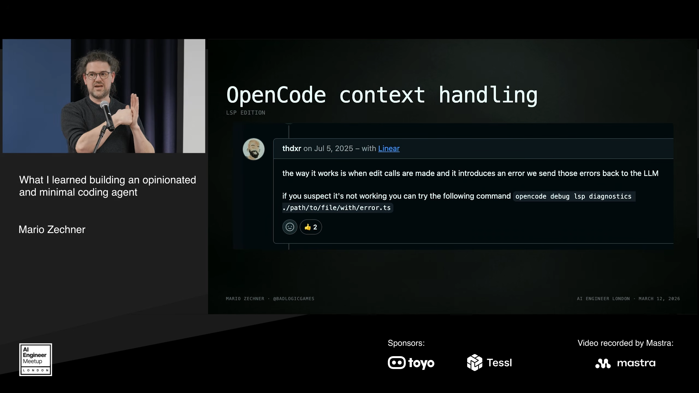

他主张使用自然的同步时点：代理认为自己已经完成一组工作后，再进行代码检查（linting）、类型检查（type checking）等验证。这个论点针对的是演讲中描述的逐次编辑反馈机制，不能直接推导为所有 LSP 功能都没有价值。

下面的流程图按讲者提出的顺序整理：

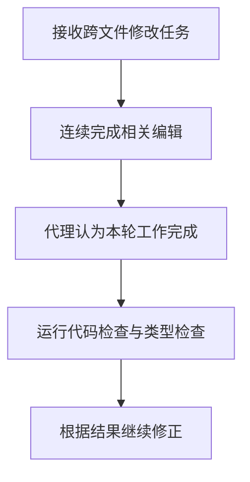

## 六、架构与信任：什么会让人放弃一个工具？

时间：[14:13–16:06](https://www.youtube.com/watch?v=Dli5slNaJu0&t=853s)

Mario 接着展示过一种会话存储方式：会话里的每条消息各写成一个 JSON 文件。他说这一实现最近已经改变，但它曾让他怀疑系统架构是否经过充分思考。

这是个人工程判断。演讲没有通过系统性的性能比较证明这种存储方式必然错误；它说明的是，当某个实现决定持续违背使用者的设计偏好时，使用者会逐渐失去信任。

他还批评了 OpenCode 当时的服务器与客户端架构。终端界面是客户端之一，桌面界面也是客户端；他指出这一结构曾出现默认配置下的远程代码执行（remote code execution）漏洞。书中保留的是演讲的历史案例，不据此判断软件如今是否仍受影响。

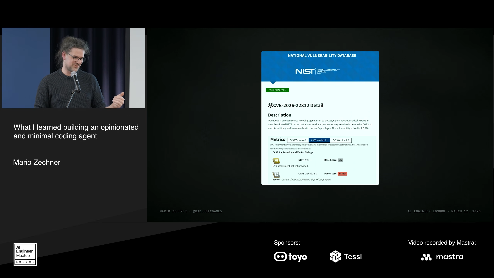

他同时承认，这个行业以极快速度发展，团队也创造了很多有用的东西。真正驱使他另起炉灶的，是这些选择与自己的要求不断错位。

商业替代品也有类似的控制边界。例如，他不喜欢由产品替自己决定每类任务只能用哪一个模型。即使一个工具很好，若关键策略无法调整，也未必适合他的工作方式。

## 七、Terminus：极简接口可以做到什么？

时间：[16:06–18:13](https://www.youtube.com/watch?v=Dli5slNaJu0&t=966s)

Terminal-Bench 是演讲中的重要转折点。它是一个评测框架（evaluation harness），包含计算机操作和编程任务。Mario 举出的任务跨度很大：从修复 Windows 环境，到编写蒙特卡洛模拟（Monte Carlo simulation）。排行榜比较的是代理运行框架（harnesses）与模型的组合。

这个基准自带的代理 Terminus，提供了极简的接口：模型得到一个 tmux 会话，向它发送按键，再读取返回的 VT 控制序列（VT code sequences）。按讲者的介绍，它没有独立的文件工具、子代理（sub-agents）或内置网页搜索，却仍处在榜单前列。

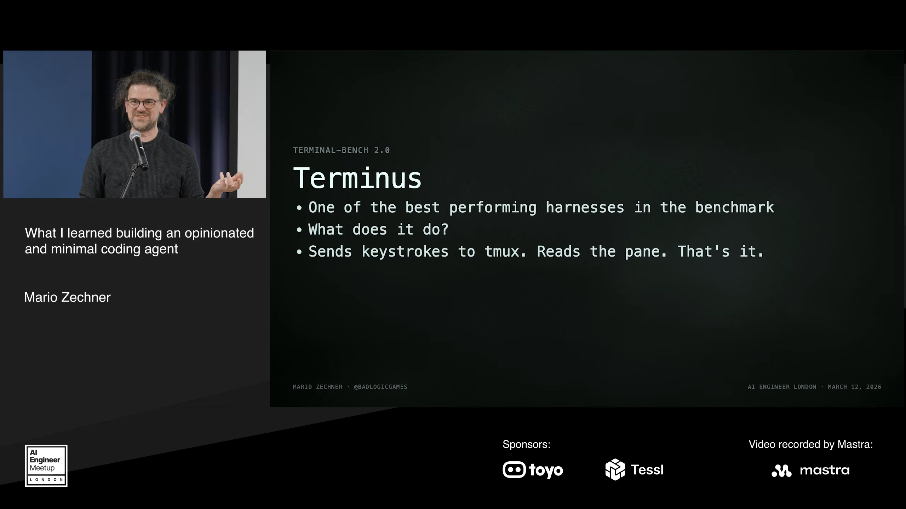

这使他重新审视功能与能力之间的关系：为了让模型完成任务，是否真的需要把现有代理的所有功能都塞进核心？

他的答案保留了另一半要求。Terminus 的模型表现很强，但它并不是他想要的用户体验或开发者体验。人类还需要与代理顺畅交互。因此，极简接口的意义是证明某些复杂功能未必是模型表现的必要条件，并不是证明用户界面可以被舍弃。

## 八、两个论点与 Pi 的四个包

时间：[18:13–20:01](https://www.youtube.com/watch?v=Dli5slNaJu0&t=1093s)

Mario 据此提出两个论点。

第一，行业仍处于探索阶段。极简代理、功能庞大的“宇宙飞船”、代理集群（swarms）、团队协作和更高自主性，都还在试验之中。没有人已经确定理想的编程代理（coding agents）究竟是什么样，也没有理由假定某一种形态已经成为最终答案。

第二，实验工具本身需要更容易修改。代理应当能够自我修改（self-modify），并具有可塑性（malleable），使人们快速尝试想法、检验新的工作流。

Pi 的做法是剥离功能，建立最小的可扩展核心（extensible core），同时保留日常使用需要的便利。它并不是一个什么都没有的空壳。

> 让编程代理适应你的需求，而不是让你适应编程代理。

### 四个包各自负责什么

| 组成 | 演讲中的职责 |
| --- | --- |
| AI 包 | 抽象多家模型提供商（providers）的不同传输协议，便于在同一会话中切换 |
| 代理核心（agent core） | 提供通用代理循环（agent loop）、工具调用、验证和流式输出（streaming） |
| 终端用户界面（TUI） | 提供日常终端交互；讲者称其核心实现大约 600 行 |
| 编程代理 | 同时提供软件开发工具包（SDK）、无界面模式（headless mode）和完整终端交互模式 |

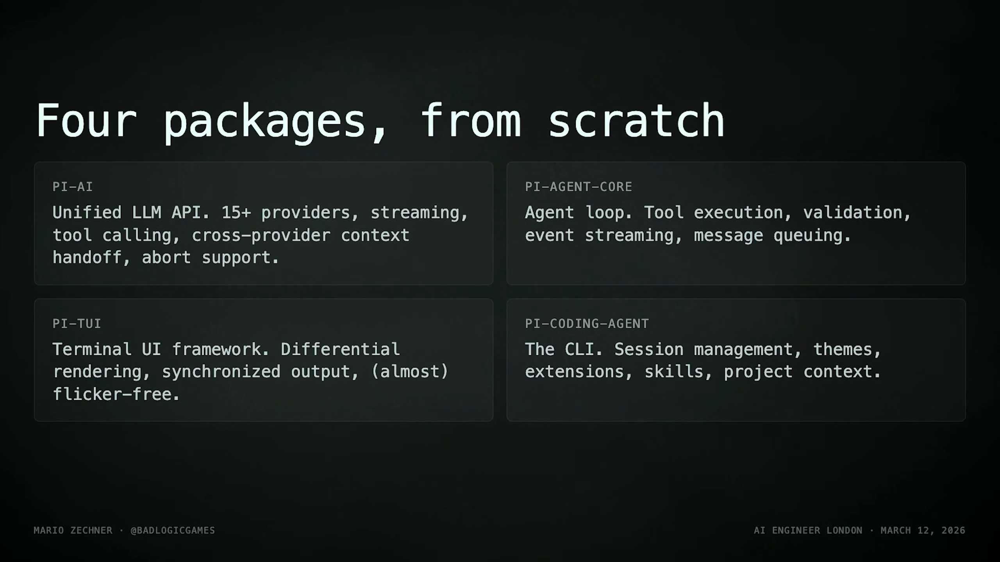

这种组织方式对应他对实验的要求：不同层次的选择应当能够被理解、替换与组合，而不是全部被锁在一个不可调整的产品流程里。

## 九、短系统提示词、四个工具与审批疲劳

时间：[20:01–21:26](https://www.youtube.com/watch?v=Dli5slNaJu0&t=1201s)

### 把模型已经学会的事情交还给模型

Mario 展示了 Pi 的完整系统提示词（system prompt），并与其他工具的提示词长度比较。它很短。他的理由是：前沿模型（frontier models）已经经过大量强化学习训练（RL trained），知道如何扮演编程代理（coding agents），因此不必反复用很长的文字解释“你是编程代理”和一般编程步骤。

这是他在演讲中提出的设计依据，而不是“所有短提示词都更好”的通用定律。演讲也没有给出逐条删除提示词的对照实验。

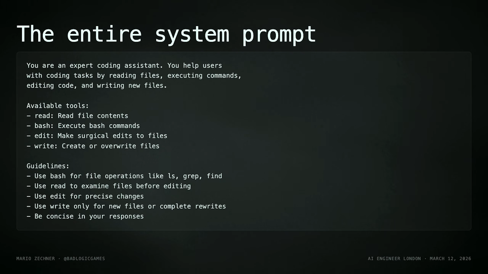

核心工具只有四个：`read`、`write`、`edit` 和 `bash`。前三者对应文件读取、写入和编辑，bash 提供通用命令执行能力。讲者用“Bash is all you need”概括这种偏好。

### 为什么讲者不信任反复确认

Pi 在演讲中采用默认放手执行的模式（YOLO by default）。Mario 认为，把安全建立在“用户每次都认真批准动作”之上并不可靠：高频确认会产生审批疲劳（fatigue），用户可能直接关闭审批，或者不读内容便连续按回车。

他对容器化（containerization）的表述也有明确限制：它不能单独解决数据外泄（exfiltration of data）和提示注入（prompt injections）。不过，与反复弹出审批对话框相比，他更倾向于把容器化视为较好的基础。

这段讨论表达了讲者对交互和防护措施（guardrails）的取舍，没有提供一套完整的安全实施方案。后面的扩展机制也保留了自行加入权限控制的可能。

## 十、不内置的功能，如何完成同样的工作？

时间：[21:26–22:40](https://www.youtube.com/watch?v=Dli5slNaJu0&t=1286s)

Pi 的最小核心有意省略一些常见功能。演讲给出的替代方式，都使用用户能观察、保存或自行修改的构件。

| 未内置的功能 | 讲者给出的替代方式 | 想保留的能力 |
| --- | --- | --- |
| MCP | 命令行工具（CLI tools）配合技能（skills），或编写扩展（extension） | 按自己的需求接入外部能力 |
| 子代理（sub-agents） | 用 tmux 再启动一个代理 | 看清输入、输出和实际执行过程 |
| 计划模式（plan mode） | 写入 `plan.md` | 得到可跨会话复用的持久产物（persistent artifact） |
| 后台 bash | 使用 tmux | 保持长期运行的终端任务 |
| 内置待办事项 | 写一个待办 Markdown 文件 | 让任务记录成为可保存、可编辑的文件 |

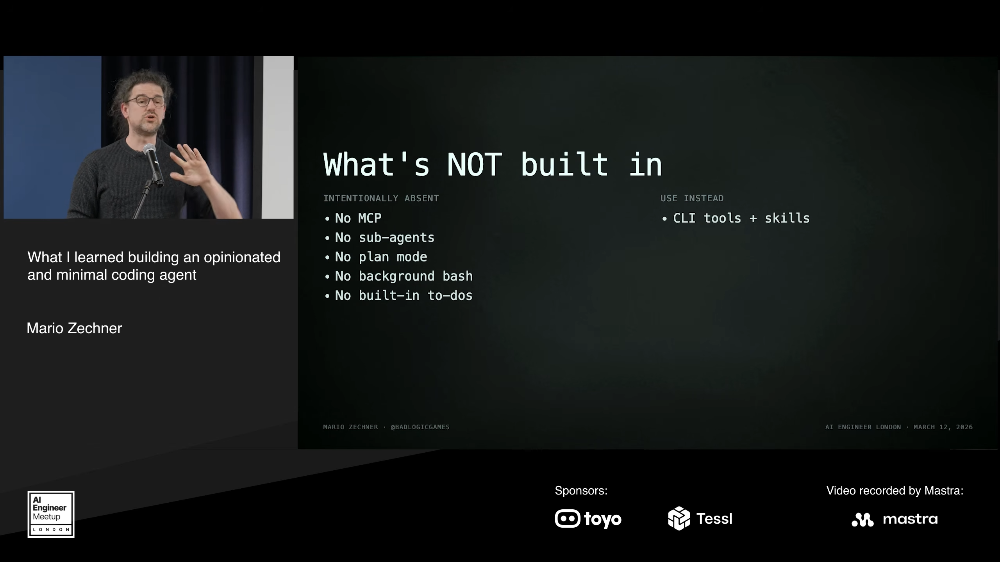

例如，计划保存在 Markdown 文件中，不受一个终端面板的显示方式限制，也能跨会话继续使用。用 tmux 启动其他代理，则让人的观察边界更清楚：输入是什么、输出是什么、运行到了哪里，都有直接的交互入口。

这些替代方式仍不是唯一答案。Mario 随后强调，如果你喜欢其他行为，就可以把这些功能按自己的方式重新做出来。Pi 的扩展能力（extensibility）正是为此存在的。

## 十一、扩展机制：把实验放进日常工作

时间：[22:19–24:59](https://www.youtube.com/watch?v=Dli5slNaJu0&t=1339s)

### 一个 TypeScript 文件即可开始

讲者介绍，Pi 可以自动加载 TypeScript 文件所定义的扩展（extension）。用户能够为大语言模型（LLM）提供自定义工具，也能够编写自定义界面（custom UI），并组合技能（skills）、提示词模板（prompt templates）和主题（themes）。这些内容可以打包到 npm 或 Git，再通过一条命令安装。

热重载（hot reloads）使这一能力进入日常工作流：在项目中用 Pi 修改扩展，再执行重新加载，变化就能进入当前使用的系统。用户可以针对当前项目或任务实验，而不必把所有功能都提前固化进核心。

### 可以修改哪些行为

| 扩展点 | 演讲举例 |
| --- | --- |
| 上下文压缩（compaction） | 尝试不同压缩策略；讲者认为现有实现仍有很大改进空间 |
| 权限控制关卡（permission gates） | 如果需要审批机制，可通过扩展实现；讲者以约 50 行代码说明其体量 |
| 自定义模型提供商（providers） | 注册代理服务、OAuth 或自托管模型（self-hosted models） |
| 覆盖内置工具 | 修改 `read`、`write`、`edit` 和 `bash` 的工作方式 |
| 完整终端界面访问（TUI access） | 自定义覆盖层、编辑区域、小组件与其他界面部分 |

Mario 自己的例子，是让四个内置工具通过 SSH 在远程机器上执行。他称自己大约五分钟就实现了。这里的时间是讲者的个案经验，并非所有扩展开发都具有相同成本。

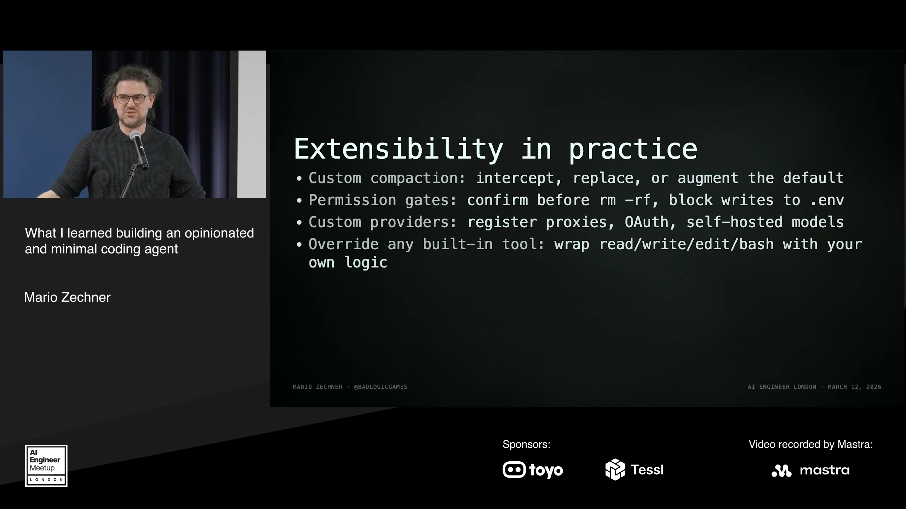

### 社区把同一个核心用于不同交互

演讲展示了一组社区扩展。它们并不是 Pi 核心内置的功能：

- `/btw` 相关扩展：讲者说，有人在很短时间内复刻了类似功能，并增加额外能力。
- Pi Messenger：让多个 Pi 代理在聊天室中通信，并通过界面观察活动；讲者也坦言自己并不熟悉其全部细节。
- `pi-nes`：在代理运行期间提供 NES 游戏界面，展示扩展界面的可塑性。
- Pi Annotate：在正在开发的网页上直接标注，把反馈放回代理上下文，促使代理继续修改。
- File Switch：在代理界面中快速查看刚改过的文件，减少切到 IDE 或其他编辑器的需要。
- Pi Web Access：演讲提到了名称，但没有解释其具体行为。

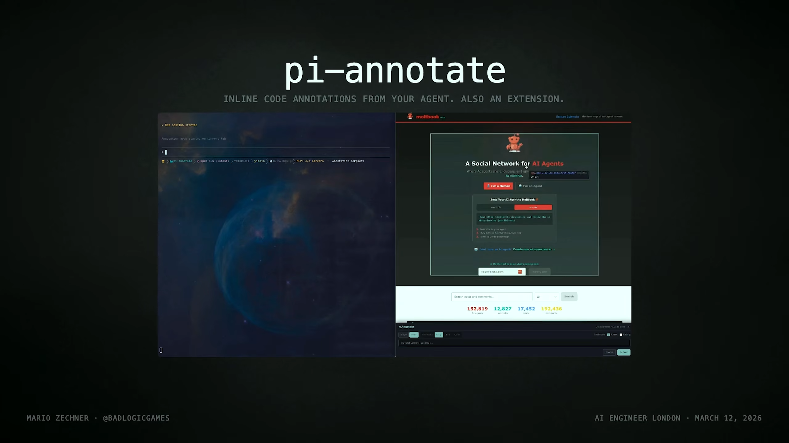

在 Mario 看来，这些案例的意义是使用者不必等核心维护者实现所有功能。几分钟到一个下午的实验，就可能得到贴合个人工作流的界面和行为。

## 十二、树形会话与评测结果

时间：[24:59–25:54](https://www.youtube.com/watch?v=Dli5slNaJu0&t=1499s)

### 会话不是一条只能向前走的线

Pi 把会话表示为树结构（tree structure）。Mario 举的工作方式是：先去读取一批文件并总结，再回到原先的会话节点，把总结带回来，继续完成真正的任务。

这种树形组织提供了一种类似子代理（sub-agents）的分支工作方式：探索过程可以展开，返回时携带摘要。它与上一章的终端用户界面访问（TUI access）是两项不同能力，原自动字幕曾把后者误识别成“tree access”。

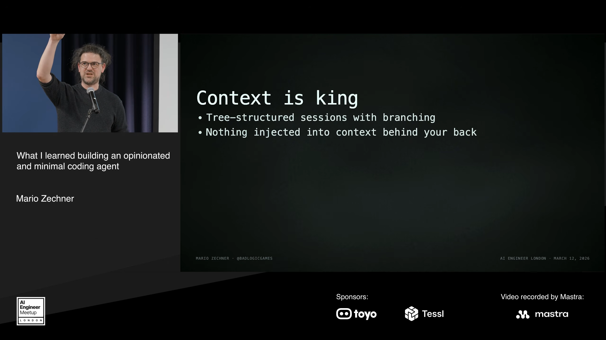

演讲还列出一些配套能力：不会背着用户注入内容，支持代理技能（agent skills）、完整成本跟踪（cost tracking）、HTML 导出、JSON 格式，以及无界面 JSON 流式输出（streaming）。这些能力共同回应了他对可观测性（observability）的要求。

### “足够小”是否还能取得好成绩？

Mario 展示的 Terminal-Bench 榜单中，Pi 与 Claude Opus 4.5 的组合排在 Terminus 2 后面。他说当时 Pi 甚至还没有上下文压缩（compaction）。

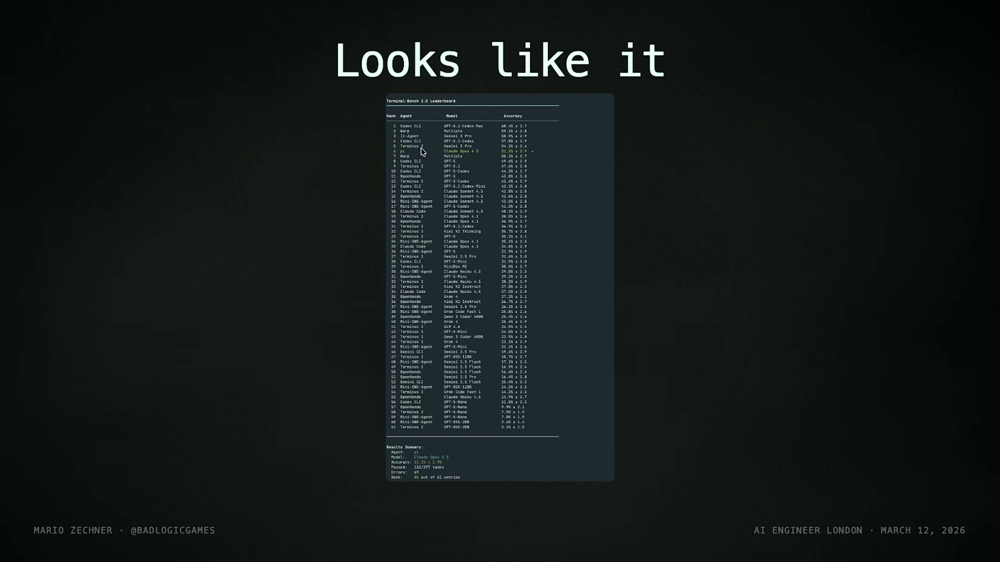

这个结果支持的是讲者的设计动机：一个较小的核心也能有竞争力。它不能单独证明 Pi 在所有任务、所有模型或今天的榜单中都领先。演讲没有展开完整实验配置，也没有给出功能逐项消融的结果，因此书中不补造额外的因果结论。

## 十三、开源维护：为人的注意力设置边界

时间：[25:54–27:15](https://www.youtube.com/watch?v=Dli5slNaJu0&t=1554s)

演讲最后从工具设计转向开源维护。与广受关注的项目发生关联后，Mario 的仓库收到大量 AI 生成的低质量内容。他认为，这使维护者的注意力成为需要主动保护的资源。

他的第一种做法是“开源休假”（OSS vacation）：暂时关闭 issues 和合并请求（PRs）入口，连续几周专心开发。他的判断是，真正重要的问题以后仍会有人反馈，或者通过 Discord 找到维护者。

第二种做法是建立人工准入名单。仓库内有一个 Markdown 文件，记录允许提交 PR 的账号。未列入其中的账号提交 PR 时，会被自动关闭。新贡献者先通过简短的 issue，用自己的话介绍自己；维护者认可后，再把账号加入名单。

这里的核心要求是“真人核验”（human verification）。讲者强调一屏以内的说明，是他对低质量投稿采取的个人维护策略，不是演讲证明了“长 issue 都是 AI 内容”。

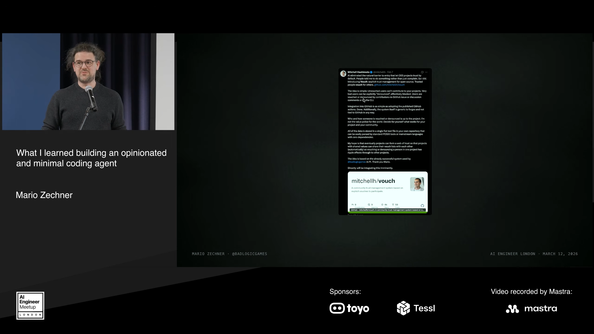

他最后提到，Ghostty 的 Mitchell 基于这一想法做了 Vouch，让类似做法更容易用于其他开源仓库。

从工具核心到开源协作，这场演讲始终关心同一件事：当代码和功能越来越容易产生时，人仍需要知道发生了什么，决定哪些东西值得保留，并能按自己的需求改变系统。

## 附记：素材与校读边界

本书使用英文平台自动字幕，经原语言订正、逐段中文翻译后编排。平台字幕在约 07:08–08:09 存在缺口，该段使用本地语音识别补录；相邻语义已核对，补录段的时间戳为近似定位。原始平台字幕与语音识别记录均保留。

现场点名产品时有一处回应不清；22:32 的一句话按上下文理解为“无需 fork”，逐段译稿中保留了说明；24:18 的游戏扩展名已由画面确认是 `pi-nes`，相邻短语仍有识别疑点。这些疑点未被扩写成新的产品事实。

讲者早期对 Claude Code 发布日期的回忆在现场被纠正；他谈基准结果时还提到“十月”，没有在书中据此补充年份。涉及当时的产品行为、漏洞和排名，应回到对应视频时点理解。

相关入口：[原视频](https://www.youtube.com/watch?v=Dli5slNaJu0)、[Pi](https://pi.dev)、[Mario Zechner](https://mariozechner.at)。
