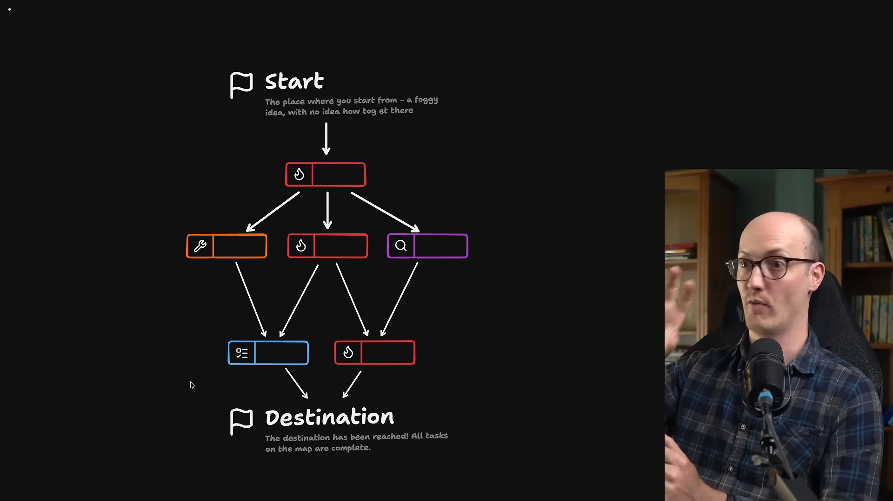
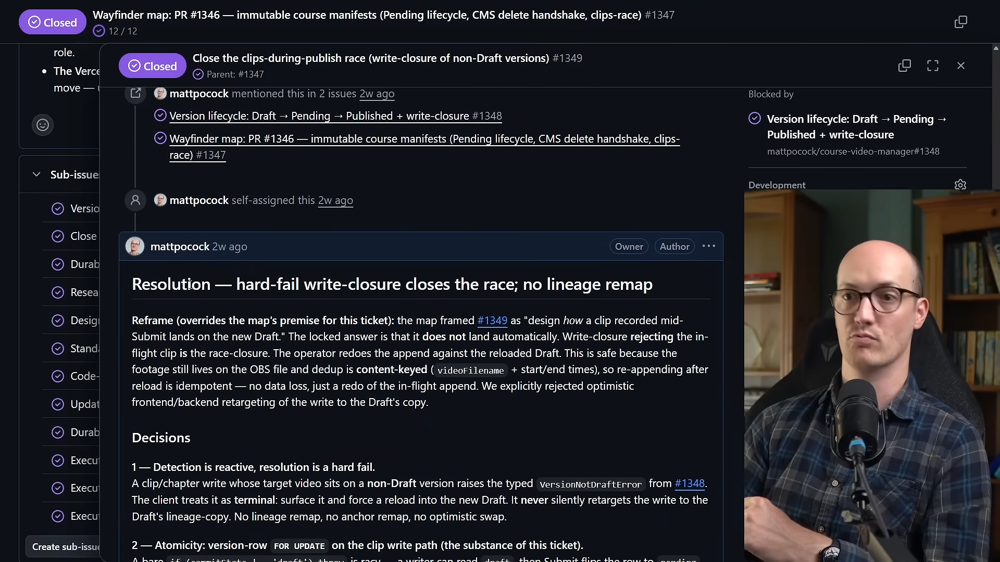
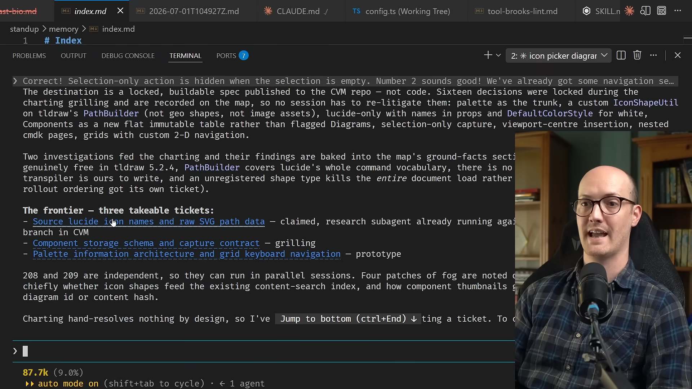
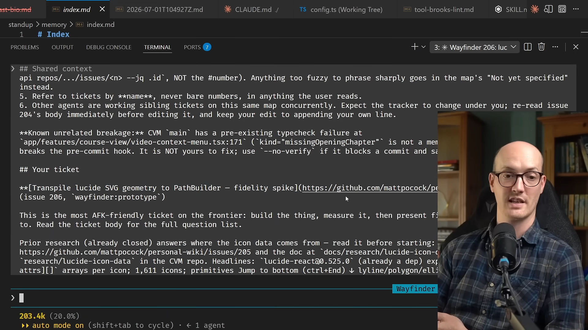
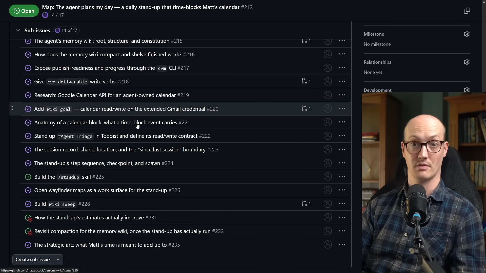
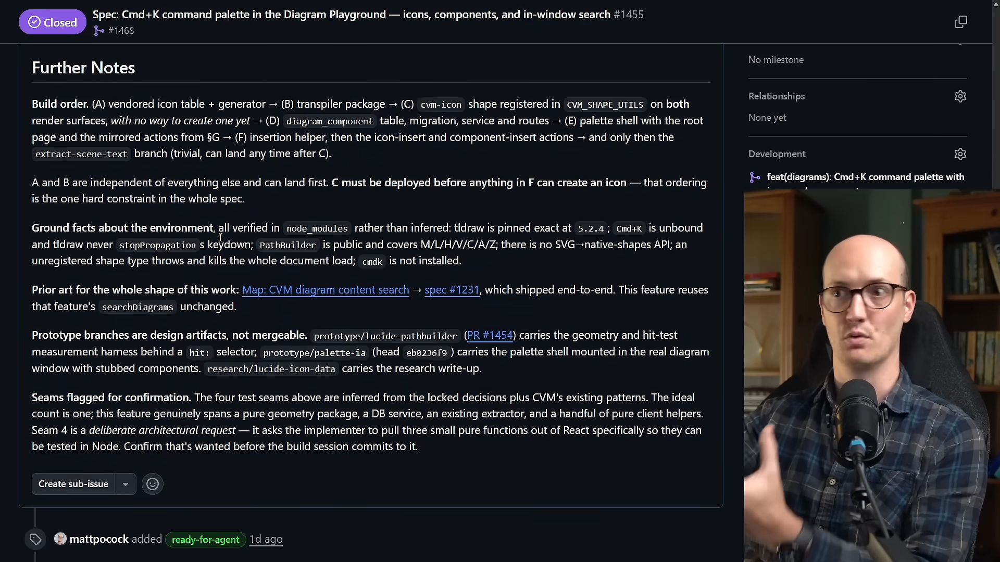
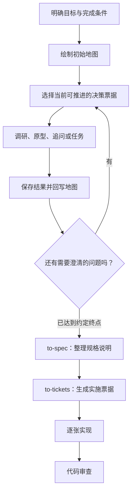
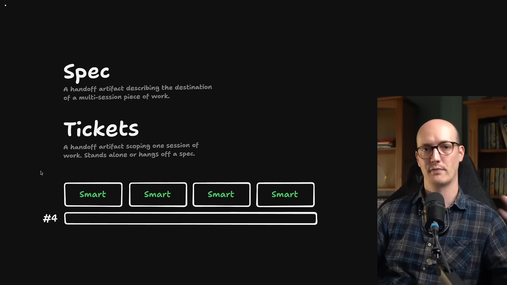

# Wayfinder：把大型工作的迷雾变成可推进的地图

> Matt Pocock · 视频《/wayfinder: Nothing is too big to plan anymore》中文整理  
> [观看原视频](https://www.youtube.com/watch?v=F3lL98Pj90o) · 时长约 15 分钟

## 1. 单次会话为什么会限制规划

**对应视频：00:00—02:10**

当一个想法大到无法在一次会话里讨论清楚时，常见做法是先把它切小，再分别交给编程代理（agent）。Matt 认为，这种切分有时发生得过早：我们尚未看清问题，就已经为了适应工具的限制缩小了目标。

他此前经常使用 `grill-me`、`grill-with-docs` 这类技能（skill），让 AI 通过追问澄清需求。这仍然是重要的基础能力，但一次追问会话能承载的内容有限。除了上下文窗口（context window）的容量，还要考虑他所说的“高效区”（smart zone）：在他看来，即使内容尚未超出窗口，代理也并非总能同样有效地处理全部上下文。

于是，规划者同时承担了两份工作：一边思考要做什么，一边控制词元（token）消耗、管理上下文，并决定哪些问题留给下一次讨论。更麻烦的是，讨论途中可能出现无法立即回答的问题。答案也许需要先调研、先做原型（prototype），或者找另一个人确认；继续追问本身并不能消除这些未知。

Wayfinder 的出发点是承认这种不确定性。规划可以由多次、不同类型的会话共同完成，并且允许在没有看清全程时先开始。视频开头提到，有使用者因为喜欢这种方式，甚至为它制作了带“星图”界面的代理运行框架（harness）。这些反馈是作者展示的使用体验，并不意味着任意大型工作都能一次自动完成。

## 2. 地图、迷雾与当前可推进的边界

**对应视频：02:10—04:30**

### 2.1 先知道目的地，再逐步发现路线

大型工作通常有一个模糊的起点，也有一个大致想抵达的终点，但两者之间并没有现成路线。Matt 用“战争迷雾”（fog of war）描述这种状态：未知的并不只是执行顺序，还包括尚未研究的问题、没有验证的假设，以及暂时无法做出的决策。

第一步往往是一次追问会话（grilling session）。AI 通过采访帮助明确基本前提和方向。简单工作可能到这里就足够了；更复杂的工作则会由这次讨论暴露出下一批需要解决的问题。

这些问题共同构成一张地图（map）。地图记录的不仅是“以后要做什么”，还包括哪些地方目前看不清、什么证据能使它们变得清楚。

### 2.2 把规划问题变成可单独处理的票据

地图上的节点是票据（ticket）。每张票据围绕一个可以单独推进的问题展开，通常对应一次独立会话。例如，有些问题需要调研，有些需要做原型（prototype），另一些需要继续讨论。

Wayfinder 会维护当前可推进边界（frontier）：已经具备足够条件、现在就能处理的那批票据。边界之外的事情仍处于迷雾中；它们可能要等待调研结果、原型反馈，或前置讨论的结论。



这个过程不是把初始任务列表机械地做完。完成一张票据后，新的信息可能解锁另一张票据，也可能暴露此前没有想到的问题。真正需要持续回答的是：**现在知道了什么，接下来能决定什么？**

除了研究和讨论，地图也可以容纳现实中的行动，例如完成配置、与某人沟通、外出办理事项。作者所强调的“协调”，包括跟踪这些工作与规划之间的关系；这不意味着代理能够亲自完成所有现实行动。

## 3. 让决策留在问题跟踪系统里

**对应视频：04:30—05:39**

Wayfinder 使用问题跟踪系统（issue tracker）保存地图和决策。在视频演示的 GitHub 仓库中，一张父 issue 表示整张地图，其下的子问题（sub-issues）承载具体的决策票据（decision tickets）。作者展示的一张地图有 12 个子项。

这种组织方式同时保留细节与概览。某个问题讨论结束后，完整解决结果写在对应子票据中；随后，一个简短版本会回写到父地图。阅读地图可以了解整体进展，遇到疑问则可以继续深入查看当初的讨论。



地图因此逐渐积累三类信息：已做出的决定、已经创建的原型，以及已经完成的任务。后续会话可以从这些持久记录继续，而不必完全依赖上一场聊天的上下文。

Matt 的演示使用 GitHub，但他说这套技能不绑定特定的问题跟踪系统，配置后也可以配合 Linear、Jira 等工具。视频字幕把设置技能误识别成了 `setup.mappercode.skills`；对照[作者的官方技能仓库](https://github.com/mattpocock/skills)，这里指的是 `setup-matt-pocock-skills`。本书只订正该名称，不把仓库后来增加的功能视为视频演示内容。

## 4. 从一个想法开始，逐张推进地图

**对应视频：05:39—07:40**

### 4.1 先定义“完成”意味着什么

开始 Wayfinder 会话时，首先要明确终点。在视频例子中，Matt 想给 CVM 的图表窗口增加命令面板（command palette），涉及图标选择、搜索其他图表、复制图表内容以及另存等操作。这是一组有关联的需求，而不是单个小修补。

他希望最终得到的是一份可以据此构建功能的规格说明（spec）。代理先探索代码仓库，再通过追问确认“完成是什么样子”，并建议把规格说明作为本轮规划的终点。初步问题回答完毕后，它创建了地图和子票据。

第一版地图中有七张票据，但当时只有三张能够立刻推进。作者举出的方向包括图标名称来源、组件存储模式（component storage schema），以及面板的信息架构（information architecture）和网格键盘操作。这个例子说明，**已经发现一张票据，不等于它已经具备开工条件。**



### 4.2 用新的会话处理具体票据

后续操作仍然使用 Wayfinder：在新会话中提供地图或票据的信息，让代理围绕该票据继续推进。

下面仅按视频口述整理调用意图，属于示意写法；尖括号中的内容需要替换为自己的需求和地址，并非视频中完整提示词的逐字抄录。

```text
/wayfinder <描述目标，并说明希望得到什么结果>

/wayfinder <需要处理的票据 URL>
```

Matt 还演示了自己的交接技能（handoff skill）：它自动写好提示词，再启动 Claude 子代理（sub-agent）。这个包装能减少手工转交上下文的步骤，但核心操作仍然是把明确的地图和票据交给 Wayfinder。



因此，Wayfinder 在两个层面都发挥作用：最初绘制地图，以及随后逐张处理地图上的票据。每次会话都可以聚焦局部问题，同时把结论写回共同的记录。

## 5. 四种票据，以及决策之间的依赖

**对应视频：07:40—09:44**

### 5.1 用不同活动消除不同的未知

| 票据类型 | 要解决的问题 | 视频中的做法 |
| --- | --- | --- |
| 调研票据（research tickets） | 缺少外部信息，暂时无法判断 | 代理寻找信息并带回结果；通常可交由子代理执行后汇报 |
| 原型票据（prototype tickets） | 仅靠描述无法判断方案是否合适 | 制作可查看或体验的原型，获得反馈 |
| 追问会话（grilling session） | 需要澄清需求、实现细节或计划中的某一方面 | 通过讨论形成决定 |
| 任务（tasks） | 需要实际行动，或需要排在其他工作之后的操作 | 跟踪现实行动，也容纳代理能够执行但尚待前置条件的工作 |

### 5.2 原型为什么重要

面对“大量规划会不会变成瀑布式开发（waterfall）”的疑问，Matt 把原型（prototype）视为关键区别。他批评的是大量低保真（low-fidelity）的前期规划：在缺少实际反馈时，先写出一套庞大的计划。

原型提供了一种高保真（high-fidelity）的反馈方式，让人能够看到实际要构建的东西，而不只是阅读它的描述。Wayfinder 在规划过程中反复引入原型，目的是让后续决定基于观察和反馈。

这里的“高保真”指反馈更接近真实体验，并不意味着原型已经达到生产质量，也不意味着原型代码必然应该进入正式实现。视频强调的是用原型帮助判断。

### 5.3 阻塞关系决定现在能做什么

票据之间存在阻塞关系（blocking relationships）：某些决策只有等其他决策做出后才有意义。这也是当前可推进边界（frontier）会不断变化的原因。

视频展示的一张地图已经完成 17 项中的 14 项，但整张地图围绕的核心技能还没有构建出来。等这个技能实际做出来之后，还需要依据它的运行方式和实际改进重新审视部分问题。计数上的“接近完成”，并不等于所有关键的不确定性已经消失。



每完成一个问题，都应查看它解锁了什么，以及是否产生了新的问题。彼此不依赖的部分可以并行推进；存在依赖的部分则需要先获得前置结果。

## 6. 从决策地图走向实现

**对应视频：09:44—11:38**

### 6.1 地图与规格说明承担不同职责

在以规格说明（spec）为终点的例子中，完整地图包含大量讨论、状态和决策。它可以作为详细的依据，但不一定适合直接当作实施说明阅读。

Matt 的做法是对地图调用 `to-spec`，再调用 `to-tickets`，生成实施票据（implementation tickets）。然后逐张实现，最后进行代码审查（code review）。他展示的规格初稿甚至超过了 GitHub issue 的字符数限制，这说明该示例积累了大量材料，而不是一个关于文档长度的建议。



以下流程图依据视频中的这一种工作方式整理；图中的规格说明是这个示例选择的终点，不是 Wayfinder 唯一允许的产物。



### 6.2 保留从摘要回到原始决定的路径

与只留下规格说明相比，Wayfinder 多保留了一层证据。规格可以链接回原先的决策票据，让人和代理在不理解某项要求时查阅一手来源（primary source）。

Matt 认为，以前 `grill-with-docs` 流程的一项弱点，是过于依赖规格说明作为事实依据（source of truth）。然而，规格终究是讨论的摘要，摘要可能省略某些前提和推理。通过决策票据，后续会话能够找到更完整的来源。

两种票据也应明确区分：规划阶段的**决策票据（decision tickets）**解决“还不知道什么、为什么这样决定”；实施阶段的实施票据则用于安排具体构建工作。两者都可能显示为 issue，但所处阶段与完成条件不同。

## 7. 什么时候值得使用这套方法

**对应视频：11:38—15:09**

### 7.1 简单工作保持简单

如果一项工作可以在单次会话中规划并完成，而且路线已经比较明确，Matt 的建议就是直接用单次会话处理。Wayfinder 适用于存在战争迷雾（fog of war）的情形：你还不知道完整路线，但已经可以开始探索。

这个判断也不限于编程。他提到，自己正在用同样的方法规划花园办公室，包括委托场地勘测、确认要联系哪些人、收集信息，以及寻找可能承建的公司。他还把它用于课程规划和工程工作。这些例子说明，方法的核心是组织未知、决定和行动，而不是某一种代码产物。

### 7.2 规格说明不必成为永久维护的第二份系统

面对“这是不是规格驱动开发（spec-driven development，SDD）”的质疑，Matt 把自己的规格说明（spec）定义为跨会话工作的目的地文档。工作太大，必须分多次会话执行，就需要某种记录让大家知道最终要到哪里；每次实施会话再由具体票据承接。



在他的个人做法中，功能实现完毕、规格已经体现在代码里之后，就会关闭承载规格说明的 issue，并不再把那份文档保留为仓库里持续维护的文件。他称这些规格为“不持久保留”（non-persistent）。关闭 issue 不等同于永久抹掉其历史记录。

作者也承认，规格驱动开发存在许多不同做法；视频中的区分是对自己工作习惯的解释，不宜把它当作对所有 SDD 流程的完整定义。

### 7.3 终点由你决定

地图的终点可以是一份交给离线自主代理（AFK agent）执行的规格说明，也可以是通过任务直接完成工作。关键是先约定想要的结果，再用调研、讨论和原型（prototype）逐步缩小未知。

视频最后提到作者在 AI Hero 上提供的七节免费课程，主题是为工程师建立可重复的 AI 技能工作流。Wayfinder 在这里体现的思路是：从模糊目标出发，把需要了解的事情写成可推进的问题，保存每次得到的结果，再据此决定下一步。

## 来源与文字核对说明

- 本书按[原视频](https://www.youtube.com/watch?v=F3lL98Pj90o)的七个主题区间整理，图像均取自该视频；流程图是依据讲解绘制的示意图。
- 原始字幕保留在本地；英文订正稿与中文译稿分别保存。字幕中的滚动重复行已去重，明显的 `detonation`、`spectrum development` 等识别错误已按语境订正。
- 设置技能的拼写对照了[作者的技能仓库](https://github.com/mattpocock/skills)；两处票据名称及开头一处反馈引语的识别疑点，均已对照视频画面核实。
